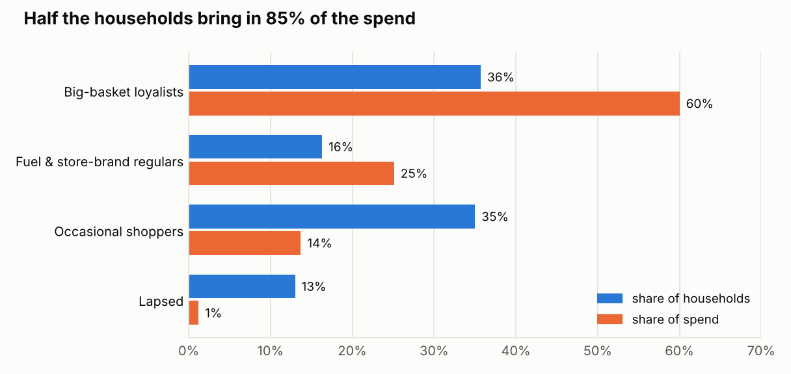
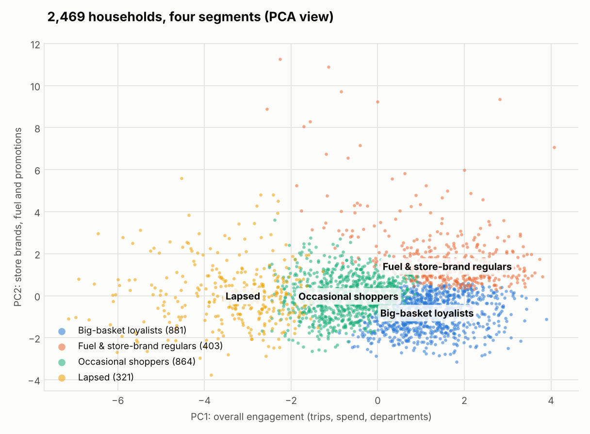
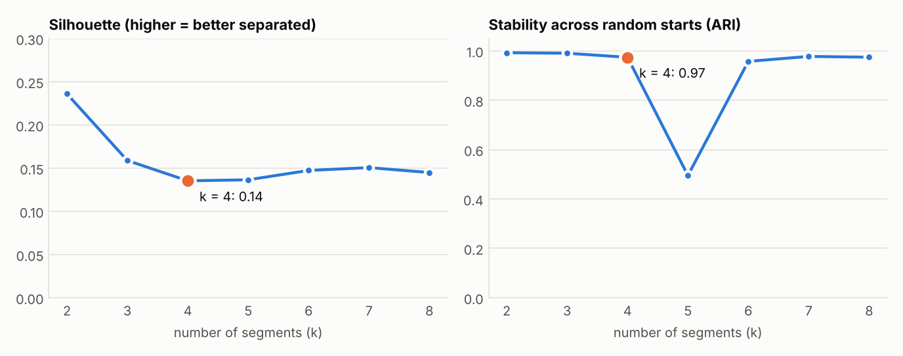

# Customer Segmentation: Grocery Households

Which kinds of shoppers does a grocery retailer have, and which ones matter most?

This project groups 2,469 households from **The Complete Journey** (a public 84.51° dataset of one year of grocery transactions) by how they shop. It uses **K-Means**, cross-checks the result with **Ward hierarchical clustering**, visualizes the segments with **PCA**, and profiles each segment by demographics.

**Timeline:** built in November 2026, applying the K-Means, hierarchical clustering and PCA methods from my MS Information Systems coursework.

## The four segments

| Segment | Households | Share of spend | Trips / year | Avg basket | On promotion | Store brand | Fuel |
|---|---|---|---|---|---|---|---|
| **Big-basket loyalists** | 881 (36%) | **60%** | 72 | $36.52 | 48% | 23% | 1% |
| **Fuel & store-brand regulars** | 403 (16%) | 25% | 89 | $27.09 | 61% | 41% | 19% |
| **Occasional shoppers** | 864 (35%) | 14% | 26 | $22.16 | 51% | 25% | 0% |
| **Lapsed** | 321 (13%) | 1% | 7 | $17.53 | 42% | 20% | 0% |

All figures are segment medians, except the household counts and share of spend.

<picture>
  <source media="(prefers-color-scheme: dark)" srcset="docs/segment_share_dark.png">
  
</picture>

- **Big-basket loyalists** shop about every five days and spend the most per trip. They are the core of the business and the least promotion-driven of the active segments.
- **Fuel & store-brand regulars** visit most often, about 89 times a year, with smaller baskets. About a fifth of their spend is fuel, two-fifths is store brand, and they buy the most on promotion. Fuel and value offers keep them coming back.
- **Occasional shoppers** are about a third of households but bring in only 14% of spend. They are the biggest growth opportunity: moving them from 26 trips toward loyalist levels is worth far more than any other shift.
- **Lapsed** households made a handful of trips and hadn't been back for about two months by the end of the year. They are a win-back list.

<picture>
  <source media="(prefers-color-scheme: dark)" srcset="docs/pca_segments_dark.png">
  
</picture>

PCA compresses the 10 features into two axes that explain 54% of the variation. **PC1 (33%)** is overall engagement: trips, spend and departments shopped. **PC2 (20%)** is the lean toward store brands, fuel and promotions. The two big-spending segments differ on PC2, not PC1: they spend similar amounts but buy different things.

## How honest are these segments?

- **The segments are not sharply separated.** Silhouette scores are low at every k (0.14 for k = 4), so households sit on a continuum, not in tight clumps. The segments are useful labels for targeting, not natural species.
- **I chose k = 4 deliberately, not by maximizing a score.** Silhouette peaks at k = 2, but that split is just light vs heavy shoppers. At k = 4, the segments differ in what people buy as well as how much, and they are stable: different random starts give almost the same segments (adjusted Rand index 0.97). At k = 5 the segments reshuffle between runs (ARI 0.50).
- **Ward clustering agrees only partly** (adjusted Rand index 0.27 against K-Means). It finds the same lapsed group and mostly the same occasional shoppers. It splits the heavy shoppers differently and merges most fuel regulars with the loyalists. The engaged vs disengaged divide holds up under both methods; the line between the two heavy-shopper segments depends on the method.

<picture>
  <source media="(prefers-color-scheme: dark)" srcset="docs/k_selection_dark.png">
  
</picture>

## Demographics

Only 801 of the 2,469 households have demographic records, and almost all of them are heavy shoppers: 498 loyalists, 201 fuel regulars, 102 occasional shoppers and no lapsed households. So demographic profiles cover the engaged segments well and the others hardly at all. Within that sample:

- Occasional shoppers lean lower-income: 40% earn under $35K, against 24–26% in the two heavy segments. They are also older: 15% are 65+, against 6–9%.
- Children make no difference. About 63% of households in every segment have none.

## Features

Each household is described by ten features built from its transactions:

| Feature | What it measures |
|---|---|
| `recency_weeks` | weeks since the last trip (by the end of the year) |
| `trips` | number of shopping trips (baskets) |
| `spend` | total spend |
| `basket_value` | average spend per trip |
| `promo_share` | share of spend bought on any discount |
| `private_share` | share of spend on store brands |
| `produce_share`, `fuel_share`, `drug_gm_share` | share of spend in each department |
| `departments` | number of different departments shopped |

Skewed counts (`trips`, `spend`, `basket_value`, `recency_weeks`) are log-transformed, then all ten features are standardized.

## Run it

```bash
pip install -r requirements.txt
python src/segment.py       # downloads the data (about 14 MB) on the first run, writes results/
python src/make_charts.py   # writes docs/*.png
```

## Files

```
src/segment.py                     features, K-Means, Ward, PCA, profiles
src/make_charts.py                 README charts (light and dark)
results/segment_profiles.csv       segment medians, sizes and spend shares
results/household_segments.csv     one row per household: features, segment, PCA coordinates
results/k_selection.csv            silhouette, inertia and stability for k = 2-8
results/pca_loadings.csv           feature loadings on PC1 and PC2
results/segment_demographics.csv   age, income, household size and kids by segment
```

## Data

The Complete Journey is © 84.51°. It is distributed in the [`completejourney`](https://github.com/bradleyboehmke/completejourney) R package, and the script downloads it from there.

See also [complete-journey-visual-stories](https://github.com/naveditachaudhary-pixel/complete-journey-visual-stories): three charts on the same data, built in R.
